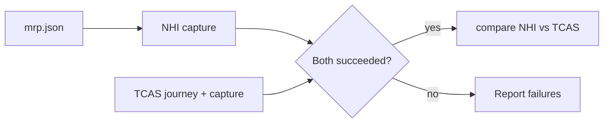

# Playwright page diff

A TypeScript Node.js CLI that captures full-page screenshots with headless Chromium
(Playwright) and compares them pixel-by-pixel, with local OCR to report what text changed.
Its main use is comparing the NHI and TCAS versions of the same Homeprotect quote page.

**Contents:** [Quick start](#quick-start) · [Commands](#commands) ·
[Configuration](#configuration) · [How quote-page works](#how-quote-page-works) ·
[Troubleshooting](#troubleshooting) · [Development](#development)

## Tech stack

- Node.js 22+, TypeScript 7 (ES modules, run with `tsx`)
- [Playwright](https://playwright.dev/) for headless Chromium capture
- [Sharp](https://sharp.pixelplumbing.com/) for image processing
- [Tesseract.js](https://github.com/naptha/tesseract.js) for local OCR
- [diff](https://github.com/kpdecker/jsdiff) for word-level text changes

## Quick start

```sh
npm install
npm run install:browser   # downloads Chromium for Playwright

# verify: should save screenshots/example.png
npm run screenshot -- https://example.com --output screenshots/example.png
```

## Commands

| Command                             | What it does                                                |
| ----------------------------------- | ----------------------------------------------------------- |
| `npm run screenshot`                | Capture a full-page screenshot of one URL                   |
| `npm run compare`                   | Compare two images and report changed regions and text      |
| `npm run quote-page`                | Capture NHI and TCAS versions of one quote and compare them |
| `npm run quote-pages`               | Run `quote-page` for every policy in a GUID list            |
| `npm run summarise`                 | Summarise every quote-page result (alias `summarize`)       |
| `npm run summarise differences`     | Show only the quote-page results that differ                |
| `npm run summarise changed-answers` | Combine every policy's answer changes and count them        |

Add `-- --help` to any command for its options (for example `npm run compare -- --help`).

### PowerShell wrapper

`Run-Project.ps1` runs every command and development task with tab completion and validated
parameters (for example a 32-character policy ID, a threshold of 0–255, or a `-Before` image
that exists). It runs from the project root wherever you call it from, so `.env` is always
found, and it exits with the command's exit code. Add `-WhatIf` to print the command without
running it; with no arguments it shows its help (`Get-Help ./Run-Project.ps1 -Examples`).

```powershell
./Run-Project.ps1 -Screenshot -Url https://example.com -Width 390 -Height 844
./Run-Project.ps1 -Compare -Before screenshots/before.png -After screenshots/after.png -NoOcr
./Run-Project.ps1 -QuotePage -PolicyDetailsId ABCDEF1234567890ABCDEF1234567890 -HistoryId 42
./Run-Project.ps1 -QuotePages                                    # first 250 entries
./Run-Project.ps1 -QuotePages -MaxCount 10
./Run-Project.ps1 -QuotePages -Guid 6819e30c2058490b8d1d9e25d267b002
./Run-Project.ps1 -RetryFailed
./Run-Project.ps1 -RetryDifferent
./Run-Project.ps1 -Summarise                                     # or -Summarize
./Run-Project.ps1 -Summarise -Mode changed-answers               # or -Mode differences
./Run-Project.ps1 -Task Verify   # Install, InstallBrowser, Build, Typecheck, Lint, Test,
                                 # TestCompare, TestQuotePage, Verify
```

When you add or change a CLI option in `src/main.ts`, update the matching parameter in
`Run-Project.ps1` and its tests in `scripts/Run-Project.Tests.ps1`.

### Output colours

Failures are shown in
red, except validation failures, which are yellow because the site rejected the copied
answers: an error summary the [journey error auto-fixes](#journey-error-auto-fixes) cannot clear,
shown on a journey section (its `div.av-timeline-all-sections` timeline is visible) or the
assumptions page, in any flow. For example `NHI journey validation failed on …`,
`NHI cover details errors: …`, `NHI assumptions errors: …` or `TCAS step 2 (click) failed:
TCAS quote errors: …`. Errors on the quote summary page stay red. A capture failure is yellow
only when every failed side stopped on validation. Progress steps are grey; `quote-pages` shows each policy's `[n/total]` line in cyan, and
a comparison summary is green when the images are identical and yellow when they differ.

### screenshot

```sh
npm run screenshot -- https://example.com
npm run screenshot -- https://example.com --output screenshots/example.png
npm run screenshot -- https://example.com --width 390 --height 844 --wait 2000
```

| Option           | Default                      | Purpose                          |
| ---------------- | ---------------------------- | -------------------------------- |
| `-o`, `--output` | `screenshots/screenshot.png` | PNG or JPEG output (overwrites)  |
| `--width`        | `1440`                       | Viewport width in pixels         |
| `--height`       | `900`                        | Viewport height in pixels        |
| `--wait`         | `1000`                       | Extra delay (ms) after scrolling |
| `--timeout`      | `30000`                      | Navigation/action timeout (ms)   |

How it works: waits for page load, scrolls through the document to trigger lazy loading,
returns to the top, waits `--wait` ms, then captures the whole document using
[Playwright's `fullPage` option](https://playwright.dev/docs/screenshots#full-page-screenshots).

Limitations:

- The scroll pass stops after 100 viewport steps, so infinite feeds capture only what loaded.
- Independently scrolling panels and virtualised lists may need site-specific handling.
- Cookie banners and login screens are captured as shown.

### compare

```sh
npm run compare -- screenshots/before.png screenshots/after.png
npm run compare -- before.png after.png --output comparisons/my-comparison
```

| Option           | Default                       | Purpose                                                    |
| ---------------- | ----------------------------- | ---------------------------------------------------------- |
| `-o`, `--output` | `comparisons/run-<timestamp>` | Report directory (must not already exist)                  |
| `--threshold`    | `20`                          | Ignore channel differences up to this (0–255; `0` = exact) |
| `--language`     | `eng`                         | OCR language                                               |
| `--no-ocr`       | —                             | Skip text extraction                                       |

The command prints the removed and added text only for regions whose recognised text
changed, then a grey count such as `115 changed regions, 12 with text changes.` Regions that
differ only visually appear in the report, not the console. Tesseract's own diagnostics (for
example `Estimating resolution as …`) are suppressed. It writes:

| File                                        | Contents                                                 |
| ------------------------------------------- | -------------------------------------------------------- |
| `diff.png`                                  | Changed pixels highlighted in magenta                    |
| `region-N-before.png`, `region-N-after.png` | Crops of each changed region, with context               |
| `report.md`                                 | Readable visual and text comparison, with OCR confidence |
| `report.json`                               | Structured results: coordinates, text, word changes      |

Good to know:

- Accepts PNG, JPEG and any other format Sharp supports. Combined canvases over 40 million
  pixels are rejected.
- Images are compared at their original coordinates (dimensions are reported separately),
  so layout shifts can produce many differences.
- Regions group adjacent changed 32-pixel tiles plus 40 pixels of context. Nearby changes
  may share a region, and crop edges can truncate long text.
- OCR runs locally — images are never uploaded. Language data downloads on first use and
  is cached in `.ocr-cache` in the output folder.
- OCR can misread small or stylised text. Check the crops and confidence before treating a
  reported text change as definitive.

### quote-page

Captures the NHI and TCAS quote pages for one policy and compares them (NHI = before,
TCAS = after). Needs [configuration](#configuration) in `.env`.

```sh
npm run quote-page -- ABCDEF1234567890ABCDEF1234567890 42
npm run quote-page -- ABCDEF1234567890ABCDEF1234567890 42 --no-ocr
```

- **Arguments:** `<policyDetailsId> <historyId>`. The policy ID is a UUID with dashes removed
  (32 hex characters), case-insensitive and normalised to uppercase.
- **Input:** `MRP_AND_QUOTE_OUTPUT_DIR/<ID>-<historyId>-mrp.json`, whose top-level
  `artemisQuoteGuid` fills `{artemisQuoteGuid}` in the NHI URL template. The TCAS template
  uses `{policyDetailsId}` and `{historyId}`. All values are URL-encoded.
- **Output:** everything for one policy and history ID goes in one folder,
  `<ID>-<historyId>/` in the [output folder](#configuration). Files appear only when they
  apply; for example there is no comparison unless both sides quoted:

  ```text
  <ID>-<historyId>/
  ├── nhi.png, tcas.png              screenshots (NHI = before, TCAS = after)
  ├── nhi-failed.png, .html          when a flow failed (likewise tcas-failed)
  ├── nhi-declined.png, .html        when a flow declined (likewise tcas-declined)
  ├── nhi-api/, tcas-api/            API responses (see below)
  ├── diff.png, region-N-before.png, region-N-after.png
  ├── report.md, report.json         the comparison
  ├── result.json                    how the run ended (see below)
  └── answer-changes.json            answers a flow changed (see below)
  ```

  Before capturing (once the inputs are valid), the policy's previous folder is deleted with
  everything in it. `quote-guid-mapping.json` is kept. Older versions wrote to `screenshots/`
  and `comparisons/<ID>-<historyId>/` instead; summarise and `retry-different` do not read
  those, so rerun the policies (or use a new `DIFF_OUTPUT_DIR`) after upgrading.

- **Result:** every run with a valid policy and history ID ends by writing
  `<ID>-<historyId>/result.json` — `outcome` (`compared`, `declined` or `failed`),
  `validation`, the failure `issues` (one line each), `startedAt` and `finishedAt` — for
  [summarise](#summarise). A run that stops before capturing (for example with no saved MRP)
  writes only this file and leaves the previous screenshots alone. If the file cannot be
  written, a yellow `Could not save the result of …` warning is shown and the run still passes
  or fails on its own result.
- **Answer changes:** when a flow changed or added answers so the journey would accept the
  test data (see [Journey error auto-fixes](#journey-error-auto-fixes)), the run also writes
  `<ID>-<historyId>/answer-changes.json`, whether it compared, declined or failed.
  See [Answer changes file](#answer-changes-file) for its format.
- **API responses:** every JSON response each flow's page gets from the site's own API
  (`/api/` on the page's origin) is saved, whether the capture succeeds or fails, in
  `<ID>-<historyId>/nhi-api/` and `tcas-api/`. Each response is one file,
  numbered in the order it arrived, such as `001-GET-quote-summary-<guid>.json`, holding the
  `url`, `method`, `status`, `requestBody` and `body` (parsed when they are JSON). An NHI Oops
  attempt and its replacement journey, or the original and replacement TCAS captures, share
  one folder, with numbering carried on. Compare the two folders to see which data behind the
  page differs, such as premiums or add-ons the quote engine returned. The responses hold the
  test policy's details, so keep the output folder local. If a response cannot be saved, a
  yellow `Could not save API response …` warning is shown and the capture carries on.
- **Masked areas:** the footer (`.hp-footer`) is painted over in flat grey in both screenshots
  (not in `-failed`/`-declined` ones), so it is never compared. It is the same on both sides,
  but OCR read its separators (`»`, `=`, `+`) differently between captures, reporting false text
  changes. Real footer differences, such as a build version, are therefore not caught. Add
  selectors to `maskedSelectors` in `src/quote-page.ts` to mask other areas. Existing
  comparisons change only when their policies are rerun.

See [How quote-page works](#how-quote-page-works) for the journey, error handling and the
NHI Oops fallback.

### quote-pages

Runs `quote-page` (with `historyId` 1) for each entry in `QUOTE_GUID_LIST_PATH` — the same
list of TCAS-format policy IDs that drives `mrp-and-quote`'s `fetch`/`compare`/`diff`
commands, one per line.

Before any policy runs (including `retry-failed` and `retry-different`), policies with no `-1-mrp.json` in
`MRP_AND_QUOTE_OUTPUT_DIR` are written to a temporary file (one per line, removed afterwards) and
fetched by running `go run . fetch --guid-file <file> --keep-output` once in the mrp-and-quote
project (`MRP_AND_QUOTE_PROJECT_DIR`, or the output folder's parent when that is not set), so only
the missing policies are fetched and every existing file is kept (this needs an mrp-and-quote
with `--guid-file` and `--keep-output` support). The fetch runs with `OUTPUT_DIR` set to
`MRP_AND_QUOTE_OUTPUT_DIR`, which mrp-and-quote's own `.env` does not override, so the files are
always saved where they are read from. Policies not in the list are reported in yellow and not
fetched, as is a project folder with no `go.mod`. A failed fetch (e.g. quotes without saved MRPs) is reported in yellow and the run
continues; policies still missing an MRP file then fail individually.

`--no-fetch` skips that fetch and uses only the MRP files already saved: it reports how many
policies have none (in yellow), and those policies fail with "No saved MRP for this quote", so
`retry-failed` can rerun them once they are fetched. Without it, existing MRP files are still
always reused; only missing ones are fetched.

```sh
npm run quote-pages                                         # first 250 entries
npm run quote-pages -- 10                                   # first 10 entries
npm run quote-pages -- 6819e30c2058490b8d1d9e25d267b002     # one entry (case-insensitive)
npm run quote-pages -- 10 --no-ocr
npm run quote-pages -- retry-failed                         # only the last run's failures
npm run quote-pages -- retry-different                      # every policy whose screenshots differed
npm run quote-pages -- 1300 --concurrency 5                 # five policies at a time
npm run quote-pages -- 20000 --no-fetch                     # only policies whose MRP is already saved
```

Policies run three at a time by default; `-c, --concurrency <n>` (1 to 100) changes that (`1` runs them one
at a time, as before) for list runs, `retry-failed` and `retry-different`. Policies start in
list order. With more than one at a time, every line a policy logs starts with its position
and the first 8 characters of its ID, such as `[42/1300 ABCD1234]`, so interleaved output can
be told apart. Each policy needs two Chromium browsers and possibly an OCR worker, roughly
0.5–0.7 GB, and puts its own load on the NHI and TCAS test environments, so raise the
concurrency with care.

Running policies at the same time is safe: a policy listed more than once (in any case) runs
once, at its first position, so each run writes only its own
`<policyDetailsId>-<historyId>` folder. Reads and updates of
`quote-guid-mapping.json` run one at a time and replace the file in one step (retrying for
up to about 1.5 s while another program, such as a virus scanner, holds it open). OCR workers
load one at a time until one has loaded, so the shared language-data cache is written once
even when a download fails.

A failed policy is reported and the run continues. At the end,
after a blank line, a summary lists the counts and then each failed policy with its issues
indented below it (only the issues and the failed count are coloured: yellow for validation
failures, otherwise red; the count is yellow only when every failure is a validation failure):

```text
Quote pages summary
9 passed (2 both declined), 1 failed.
8230224DF66644A1A52173E3757EE8BD-1
  Quote capture failed; comparison skipped.
  NHI: Website displayed <h2>Oops</h2>; stopping the journey. (https://…)
```

The exit code is non-zero if any policy failed. A policy where
[both sides declined](#declined-quotes) counts as passed.

#### Retrying failures

A list run replaces `quote-pages-failed.json` in the current directory with that run's failed
policy IDs, history ID and issues; a run where nothing failed deletes the file. It is
git-ignored. The file is also saved as the run starts and after each policy, listing the
policies not finished yet with the issue `Not finished: the run stopped before this policy
completed.`, so a run stopped part way (for example with Ctrl+C) leaves its failures and
every unfinished policy for `retry-failed`. `npm run quote-pages -- retry-failed` reruns only those policies — passed
policies and their output are left alone — then replaces the file with the ones still
failing (or deletes it when all pass), so repeated retries shrink the list. Replacement GUIDs
already in `quote-guid-mapping.json` are reused. With no file it prints
`No failed quote pages to retry` and exits successfully.

One-off runs — a single `<guid>` or a `maxCount` of 1 — leave the file untouched, as does a run
stopped with Ctrl+C.

#### Retrying differences

`npm run quote-pages -- retry-different` reruns every policy folder in the output folder whose
`report.json` has changed pixels — the policies [summarise](#summarise) counts as different —
each with the history ID from its folder name. Identical, both-declined, failed and unrecorded
policies are left alone (use `retry-failed` for failures). Use it after changing how pages are
captured, such as [masking an area](#quote-page), to refresh the existing comparisons.
`quote-pages-failed.json` is left untouched, so earlier failures stay available to
`retry-failed`; a policy that now fails records why in its `result.json`. With nothing
different it prints `No different quote pages to retry` and exits successfully.

### summarise

Summarises every `<ID>-<historyId>` folder in the output folder, so you can review a whole
run (or several) at once. `npm run summarize` does the same. Other folders, such as
`.ocr-cache`, `screenshots` and `comparisons`, are skipped. The exit code is 0 whatever the results.

```sh
npm run summarise
```

Each folder's `result.json` gives its outcome. A folder with only a `report.json` (from a run
before results were saved) counts as compared, since a report exists only when both sides were
captured; failures from those older runs were not recorded, so rerun them to see their reasons.
In order, it prints:

| Section                   | Contents                                                                                                                                                                                                                                                            |
| ------------------------- | ------------------------------------------------------------------------------------------------------------------------------------------------------------------------------------------------------------------------------------------------------------------- |
| Visual-only differences   | Compared policies whose images differ with no text change, largest change first, with the changed percent and any difference in page size                                                                                                                           |
| Text differences          | Each policy with text changes, then each region's changed OCR lines (`- £137.63`, `+ £137.62`); whole lines are compared rather than words, so the change has context. A region where a side with text has OCR confidence below 60 is marked `(low OCR confidence)` |
| Most common text changes  | The 10 most frequent changes seen in more than one region, for example `25× £137.63 → £137.62`                                                                                                                                                                      |
| Failed policies           | Each failed policy with its issues, coloured as in [quote-pages](#quote-pages)                                                                                                                                                                                      |
| Failures by reason        | Each issue with the number of policies reporting it; URLs, file paths and IDs are ignored so the same error groups together (dates such as `DD/MM/YYYY` are kept)                                                                                                   |
| MRP records not retrieved | GUID list entries with no `<ID>-1-mrp.json` in `MRP_AND_QUOTE_OUTPUT_DIR`                                                                                                                                                                                           |
| Totals                    | The GUID list size, how many have a result and how many do not (not run, or an empty folder); the compared, identical, different, declined and failed counts; and the Oops pages                                                                                    |

```text
Totals
GUID list: 1264 policies (…/quoteGuids.txt); 1236 with a result, 28 without; 10 MRP records not retrieved.
1237 policies: 1237 compared (833 identical, 404 different, 67 with text changes), 0 both declined, 0 failed.
Oops pages: NHI 957 (953 later compared or declined), TCAS 10 (1 later compared or declined).
```

- **GUID list:** read from `QUOTE_GUID_LIST_PATH` and `MRP_AND_QUOTE_OUTPUT_DIR` in `.env`.
  Unlike for the other commands, both are optional; without them the GUID list line and MRP
  section are skipped.
- **Oops pages:** counts the `<ID>-<historyId>/nhi-failed.html` and
  `tcas-failed.html` pages that show the Oops heading. A policy that "later compared or
  declined" recovered, usually through the [NHI Oops fallback](#nhi-oops-fallback). A page
  saved before the policy's last recorded run started (`startedAt`) is left over from an earlier
  run and is not counted.

To see only what differs, add `differences`:

```sh
npm run summarise differences
```

This prints the Visual-only differences, Text differences and Most common text changes
sections, then how many of the compared policies differ (the policies
[`retry-different`](#quote-pages) reruns), for example `404 different of 1237 compared.`
Failures, MRP records, the GUID list and Oops pages are left out. Each policy is shown by the
full path of its policy folder rather than its folder name, so you can Ctrl+click it in
most terminals to open the screenshots and report.

To see which answers the [journey fixes](#answer-changes-file) changed across every policy,
add `changed-answers`:

```sh
npm run summarise changed-answers
```

This combines every `<ID>-<historyId>/answer-changes.json` into one
`changed-answers.json` in the output folder (`DIFF_OUTPUT_DIR`), replacing any earlier one. Its
keys are the policy folder names, each holding that policy's `nhi` and `tcas` changes by section,
as in its own file. Cover start changes are left out, since nearly every run moves the cover
start into range, and so is any section, flow or policy left with no other change. It then
prints how many times each question was changed, most changed first, and the totals:

```text
Changed answers (…/playright-diff-output; cover start ignored)
  70× NHI   Property circumstances  rebuilding cost
   4× NHI   Contact details         email address
   4× TCAS  Contact details         email address

Totals
70 policies with changes, 78 changes.
Saved to …/changed-answers.json
```

A question changed more than once for one policy (such as each claim) is counted each time.

## Configuration

Every command reads `.env` in the current working directory. `quote-page`, `quote-pages` and
`summarise` take their settings from it, and every command takes `DIFF_OUTPUT_DIR` from it. The
committed `.env` targets the feature-dev environment and writes output to
`D:/temp/playright-diff-output`.

| Variable                                      | Used by       | Purpose                                                                                                   |
| --------------------------------------------- | ------------- | --------------------------------------------------------------------------------------------------------- |
| `DIFF_OUTPUT_DIR`                             | all commands  | Optional folder holding each policy's `<ID>-<historyId>/` folder (default: the current working directory) |
| `MRP_AND_QUOTE_OUTPUT_DIR`                    | both          | Folder containing `<ID>-<historyId>-mrp.json` files                                                       |
| `MRP_AND_QUOTE_PROJECT_DIR`                   | `quote-pages` | Optional mrp-and-quote project folder the MRP fetch runs in                                               |
| `QUOTE_PAGE_TIMEOUT`                          | both          | Optional step timeout per capture, e.g. `45s` or `1m` (default `30s`)                                     |
| `QUOTE_JOURNEY_NHI_QUOTE_PAGE_URL_TEMPLATE`   | both          | NHI quote URL, with `{artemisQuoteGuid}`                                                                  |
| `QUOTE_JOURNEY_NHI_UNSAVED_URL_TEMPLATE`      | both          | Unsaved replacement journey URL (`nhi=false`)                                                             |
| `QUOTE_JOURNEY_TCAS_QUOTE_PAGE_URL_TEMPLATE`  | both          | TCAS quote URL, with `{policyDetailsId}` and `{historyId}`                                                |
| `QUOTE_JOURNEY_TCAS_REPLACEMENT_URL_TEMPLATE` | both          | TCAS quote summary URL for a replacement GUID, with `{artemisQuoteGuid}`                                  |
| `QUOTE_JOURNEY_QUOTE_GUID_URL`                | both          | [NHI Oops fallback](#nhi-oops-fallback) endpoint                                                          |
| `QUOTE_JOURNEY_AGENT_ID`                      | both          | Fallback request `agentId`                                                                                |
| `QUOTE_JOURNEY_BRANCH_CODE`                   | both          | Fallback request `branchCode`                                                                             |
| `QUOTE_JOURNEY_CALL_MEDIA_USER`               | both          | Fallback request `callMediaUser`                                                                          |
| `QUOTE_GUID_LIST_PATH`                        | `quote-pages` | GUID list file, one policy ID per line (also used by `retry-failed`)                                      |

All variables listed for a command are required, except `DIFF_OUTPUT_DIR`, `MRP_AND_QUOTE_PROJECT_DIR` (default: the
output folder's parent) and `QUOTE_PAGE_TIMEOUT`. Policy folders, `screenshots/` and
`comparisons/` paths in this README (including defaults and the OCR cache) are inside
`DIFF_OUTPUT_DIR` when it is set; paths
you pass yourself, such as `--output`, are not. `quote-guid-mapping.json` and
`quote-pages-failed.json` always stay in the current working directory. `QUOTE_PAGE_TIMEOUT` is a whole number with an
optional `s`, `m`, `h` or `d` suffix (milliseconds without one), from 1 ms to 8 hours, matching
how `intervalToMs` in `@avantia/client-and-server-utilities` reads it (`src/interval.ts` is this
project's own copy). It is how long each page load, click and wait for the next page may take;
quote loading screens get twice as long, and a wait that is still on a loading screen when it
runs out is tried once more, so a slow quote can take up to three times as long in all. Set
`NO_COLOR` to any value to print the logs without colours, for example when saving them to a
file. `summarise` also reads `QUOTE_GUID_LIST_PATH` and
`MRP_AND_QUOTE_OUTPUT_DIR`, but both are optional there (see [summarise](#summarise)).

Rules:

- Existing environment variables take precedence over `.env`.
- `${VARIABLE_NAME}` references another `.env` setting or environment variable. References
  resolve recursively (forward references included) when a command reads the setting, so a
  reference only some commands use (such as `${REPO_BASE_PATH}`) does not stop the others or
  `--help`. A missing or circular reference in a setting the command reads stops it with an
  error.
- URL placeholders such as `{policyDetailsId}` are left alone until `quote-page` fills them.
- Relative paths resolve from the current working directory.
- URL shapes come from Quote Journey's `/api/developer/links` (for example
  `https://quotes-feature-dev.homeprotect.co.uk/api/developer/links`), which lists every entry
  point for a quote GUID or policy. Check it when adding or changing a template.

`REPO_BASE_PATH` is usually set in your environment, but you can also set it in `.env`:

```dotenv
REPO_BASE_PATH=D:/Richard/Projects/github
MRP_AND_QUOTE_PROJECT_DIR="${REPO_BASE_PATH}/GoPackages/internal/mrp-and-quote"
```

## How quote-page works

NHI and TCAS run **concurrently**, and both finish even if one fails. When NHI uses a
replacement quote GUID, TCAS is captured from that GUID instead (see
[TCAS for a replacement GUID](#tcas-for-a-replacement-guid)). Failures are reported
per flow, and the comparison runs only when both captures succeed. Each flow logs every URL
it opens (`NHI: opening <url>`, `TCAS: opening <url>`), and each failure message ends with
the URL that failed.



### TCAS journey

Before capturing TCAS, the steps in `src/tcas-quote.steps.json` run in order:

1. Wait for **Cover details**.
2. Click **Contact details**.
3. Click **Get your quote**.
4. Wait for either an error summary or the welcome quote heading ("here's your quote",
   "here's your conditional quote" or "here's your estimated quote", any customer name,
   straight or curly apostrophes). An estimated quote is a referral ("We need to double check a
   few details with you") that still shows a price, so it is captured and compared as usual.

Edit the JSON file to change selectors or steps. Each successful step is logged in grey
with its number, action and elapsed milliseconds; a failure names the step that stopped.

After each click, the action waits for the page's `/api/` requests to finish (no request for
500 ms, or 10 s at most), since the site can show an error summary only after a server-side
check and can leave the previous one on screen for a moment after a retry. It then checks for
`div.av-card-error-summary`. If present, it prints
the text of each `.av-card-error-summary > ul > li > a` link (or the full summary text if
there are no links) and stops the journey and comparison.

The **Contact details** and **Get your quote** clicks (steps with `"recoverJourneyErrors":
true`) fix rejected test data once per error, as described in
[Journey error auto-fixes](#journey-error-auto-fixes), then retry the click (logged in grey
as for example `TCAS: clicking Get your quote again.`). Any remaining
errors stop the journey as usual.

### Quote summary and assumptions

The NHI quote URL and the [replacement TCAS](#tcas-for-a-replacement-guid) URL open a quote
summary, which can show these pages before its quote page, in either order, and either can
be missing. Before capturing, the action clicks through whichever appears (each click is
logged in grey) until the welcome quote heading appears, so the screenshot shows the quote
page:

| Page                                                                        | Button clicked                                                |
| --------------------------------------------------------------------------- | ------------------------------------------------------------- |
| Quote summary ("Welcome …, thank you for choosing Homeprotect", with price) | **Continue with quote** (`#hp-summary-continue-button`)       |
| Assumptions ("Are you happy with these assumptions?")                       | **Yes, take me to my quote** (`#hp-assumptions-quote-button`) |

- A page already showing the quote is captured as it is. **No, I need to make changes** is
  never clicked.
- An error summary after a click is reported (for example `NHI assumptions errors: …` or
  `TCAS quote summary errors: …`) and
  the comparison is skipped.
- The flow stops after 5 clicks without reaching the quote.
- If a click returns to the journey with an error the action can fix (see below), it fixes it
  once and clicks **Return to quote** (`button.hp-submit-form`, logged as for example
  `NHI: clicking Return to quote on Cover details.`), which goes straight to the quote page. An
  error shown again, or left on screen until the timeout, is reported as for example
  `NHI cover details errors: …`.

### Journey error auto-fixes

Some errors come from the test data rather than the quote, so the action fixes them
(`src/journey-fixes.ts`) and carries on:

- **"The Cover start field needs to be between YYYY-MM-DD and …"** (**Cover details**): opens
  `svg.av-icon-calendar` and picks the calendar `div` whose aria-label ends with the earliest
  allowed date (for example `October 6th, 2026`), skipping days outside the month. The
  calendar opens on the month of the date already given, so it is first moved with **Next
  Month** or **Previous Month** until that day is shown (up to 24 months).
- **"The renovationEnd field needs to be between YYYY-MM-DD and …"** (**Property
  circumstances**): picks the earliest allowed date (for example `13 October 2026`) from the
  day, month and year dropdowns (`button.dropdown-toggle[id$="~Kday"]` and so on) of the
  question showing the error ("When is the work due to be completed?").
- **"The Email address field contains invalid characters"** (**Contact details**): enters
  `nobody.special@nhitest.com` in `input[name="email"]`.
- **"Enter the cost of rebuilding the property"** (**Property circumstances**): selects
  **Choose another amount** (`label[id$="~Kother"]`) unless it already has the `active` class
  or is not offered (no BCIS estimate), then enters `249995` in `input[name="rebuildingCost"]`.

- Each fix first opens its section from the timeline
  (`div.av-timeline-all-sections > ul > li[title="…"]`), unless that `<h1>` heading is
  already shown. Every action is logged in grey, for example:

  ```text
  NHI: entering rebuilding cost 249995 on Property circumstances.
  NHI: opening Property circumstances from the timeline.
  NHI: selecting Choose another amount.
  ```

#### Unanswered questions

Errors shown on a question (a `div.av-input-error` whose `div.av-error-message` has the text)
are answered with a fixed value, on every question that shows the error and has the field
(for example each claim). Dropdowns are answered by clicking the toggle and then the
`.dropdown-menu.show button.dropdown-item` with the answer text; an autocomplete by typing
the answer and then clicking the suggestion with that text; a checkbox list by ticking the
`input[type="checkbox"]` whose label has the answer text (other ticked boxes are kept, and a
box already ticked stays ticked); and a date by picking each part from the toggles whose ids
end `~Kday`, `~Kmonth` and `~Kyear`. Property usage is answered before who lives at the
property, as "I live here permanently" ticks You there, which can clear that error.

| Error message                                                | Field                                                   | Answer (on section)                                                                                                |
| ------------------------------------------------------------ | ------------------------------------------------------- | ------------------------------------------------------------------------------------------------------------------ |
| "Must be between £1 and £10,000,000."                        | `input[name="claimPaid"]`                               | `55782` (**Household details**)                                                                                    |
| "Please select a claim/loss from the list."                  | `div.dropdown[name="claimType"]`                        | Escape of water - other cause (**Household details**)                                                              |
| "Please select what your roof is made of."                   | `div.dropdown[name="roofMaterial"]`                     | Slate (**Property construction**)                                                                                  |
| "Please select what your external walls are made of."        | `div.hp-float > label`                                  | Brick (**Property construction**)                                                                                  |
| "Please tell us what type of house it is."                   | `div.dropdown[name="houseType"]`                        | Detached House (**Property type**)                                                                                 |
| "Please answer this question."                               | `button[name="ownOrRent"]`                              | Own (Mortgage) (**Property type**)                                                                                 |
| "Please enter the year the property was built."              | `input[name="yearBuilt"]`                               | `1990` (**Property type**)                                                                                         |
| "Please select the number of bedrooms."                      | `button[name="bedrooms"]`                               | 3 (**Property type**)                                                                                              |
| "Please select the number of bathrooms."                     | `button[name="bathrooms"]`                              | 1 (**Property type**)                                                                                              |
| "Please enter how long you held this type of insurance for." | `button[name="insuranceTypeLength"]`                    | 5 (**Property type**)                                                                                              |
| "Enter the total replacement value of your contents"         | `input[name="contentsCost"]`                            | `50000` (**Your contents**)                                                                                        |
| "The Safe rating field must contain a value"                 | `button[name="safeRating"]`                             | UK: £1k /£10k (**Your contents**)                                                                                  |
| "The Flood cause field must contain a value"                 | `button[name="floodCause"]`                             | Flood (**Property circumstances**)                                                                                 |
| "Please select day, month and year."                         | `button.dropdown-toggle[id$="~Kday"]`                   | 1 January, two years before this year (any date question; the year dropdown offers this year and the 25 before it) |
| "The Tree location field must contain a value"               | `button[name="treeLocation"]`                           | Your property (**Property circumstances**)                                                                         |
| "The Tree distance field must contain a value"               | `input[name="nearbyTreeDistance"]`                      | `5` (**Property circumstances**)                                                                                   |
| "The Damage caused by tree field must contain a value"       | `button[name="nearbyTreesCausedDamage"]`                | No (**Property circumstances**)                                                                                    |
| "Enter the criminal conviction that they were convicted of"  | `input[name="criminalConvictionType"]`                  | Theft, chosen from the suggestions (**Household details**)                                                         |
| "The distance must be within 7 metres of the property."      | `input[name="nearbyTreeDistance"]`                      | `5` (**Property circumstances**)                                                                                   |
| "Please select an criminal conviction from the list."        | `input[name="criminalConvictionType"]`                  | Theft, chosen from the suggestions (**Household details**)                                                         |
| "Please select yes or no."                                   | `button[name="flood"]`                                  | No (**Property circumstances**)                                                                                    |
| "Please select an option."                                   | `div.hp-float > label:has(img[alt="Multi-point lock"])` | Multi-point lock, on the main entrance lock (**Property circumstances**)                                           |
| "Please select an option."                                   | `button[name="patioLockType"]`                          | Multi-point lock (**Property circumstances**)                                                                      |
| "Please select an option."                                   | `button[name="otherExitsLockType"]`                     | No other exit (**Property circumstances**)                                                                         |
| "Please select an option."                                   | `div.dropdown[name="howIsThePropertyUsed"]`             | I live here permanently (inc. rented homes) (**Resident details**)                                                 |
| "The Who lives at the property field must contain a value"   | `div.form-check`                                        | You, ticked (**Resident details**)                                                                                 |
| "Please tell us how many adults live at the property."       | `button[name="adults"]`                                 | 1 (**Resident details**)                                                                                           |
| "Please tell us how many children live at the property."     | `button[name="children"]`                               | 0 (**Resident details**)                                                                                           |
| "Please select an option."                                   | `button[name="whenIsOccupied"]`                         | Day and night (**Resident details**)                                                                               |
| "Please select an option."                                   | `button[name="consecutiveDaysUnoccupied"]`              | 0-30 (**Resident details**)                                                                                        |

- A message other questions share (such as "Please answer this question." or "Please
  select an option.") is left alone
  when no question showing it has the field, so it is reported as usual.
- Each answer is logged in grey, for example
  `NHI: entering claim value 55782 on Household details.` or
  `NHI: selecting roof material Slate on Property construction.`

#### All fixes

- Each error is fixed at most once per flow; if it comes back, it is reported as usual.
- This applies to the quote summary flows (NHI and replacement TCAS), the TCAS journey's
  Contact details and Get your quote steps, and the unsaved NHI journey (`nhi=false`).
- In the unsaved journey, an error from **Continue** or from **Get your quote** returning to
  a section is fixed, then the journey is walked again from the fixed section; a return fixed
  this way does not count towards the one-return limit.

#### Answer changes file

Every answer a fix changes is saved in `<ID>-<historyId>/answer-changes.json`,
grouped by flow (`nhi`, then `tcas`) and then by section, in the order the changes were
made. A question changed more than once (such as each claim) has one entry each time. Flows
with no changes are left out. When nothing was changed the file is not written, and any file
an earlier run left is removed. Only the captures whose screenshots are used count: when NHI
shows Oops and a replacement quote is captured instead, the changes made by the Oops attempt
and by the original TCAS capture are left out.

```json
{
  "policyDetailsId": "ABCDEF1234567890ABCDEF1234567890",
  "historyId": 1,
  "changes": {
    "nhi": {
      "Property type": [
        {
          "question": "bedrooms",
          "before": null,
          "after": "3",
          "error": "Please select the number of bedrooms."
        }
      ]
    },
    "tcas": {
      "Cover details": [
        {
          "question": "cover start",
          "before": "27 Aug 2026",
          "after": "06 Oct 2026",
          "error": "The Cover start field needs to be between 2026-10-06 and 2026-11-20"
        }
      ]
    }
  }
}
```

- `before` is the answer the page showed, read just before the fix: a field's value, the
  selected button (`button.btn-primary`) or ticked image (`label.hp-checked`), a dropdown
  toggle's text, the ticked checkboxes' labels (joined by commas), or the day, month and year
  toggles (joined by spaces). It is `null` when nothing was shown.
- `after` is the answer given. Dates and checkbox lists are read back from the page once the
  fix is made, so they are recorded exactly as shown: cover start as its field shows it (e.g.
  `06 Oct 2026`), day, month and year dropdowns as their toggles show them (e.g.
  `13 October 2026`), and a checkbox list including any boxes that were already ticked.
- `error` is the error summary line that led to the change.
- If the file cannot be written, a yellow `Could not save the answer changes of …` warning is
  shown and the run still passes or fails on its own result.

### Annual payments

Once any flow reaches the quote page, and before the screenshot, the action makes sure
**Pay annually** is selected, so NHI and TCAS are compared at the same price. If Pay monthly
is selected, it clicks `button[name="paymentSelector"][id$="~Kannually"]` (logged in grey as
`NHI: selecting Pay annually.`) and waits for `.hp-selected-box` to appear inside it; the loading
wait before capture then covers any price refresh. A quote page with no payment selector is
captured as shown, with a grey log line. If Pay annually does not become selected, the flow
fails.

### Loading screens and Oops pages

- Both flows wait for `<h2>Loading your quote</h2>` and `div.hp-loading-widget-screen` to
  disappear, and check again just before capture. Loading screens get twice the step timeout
  (60 seconds by default, against 30 for every other step); a loading screen that never clears
  fails without saving a screenshot of it.
- If a wait for the quote page times out while a loading screen is still shown, the flow logs
  `Loading screen still shown; allowing up to 30 s more.`, waits for the loading screen to
  clear within that time, and then waits for the quote page once more.
- Only a loading screen that does not clear is reported as a timeout. When a wait for the next
  page (TCAS step 4, a quote summary click, or the unsaved journey's quote) runs out with no
  loading screen shown, the page has settled somewhere unexpected rather than being slow, so it
  is reported as for example
  `Expected page did not appear within 30 s and no loading screen is shown; page shows "Property circumstances".`
  The visible `h1` headings (journey section names) identify the page; `h2` headings are left
  out because they can hold the customer's name. Other steps, such as clicks, keep Playwright's
  timeout message.
- Both flows watch for an `h2` containing exactly `Oops` from navigation through capture.
  If one appears, the flow stops, saves a failure screenshot, and skips remaining steps and
  the comparison. NHI first tries the [fallback](#nhi-oops-fallback).

### Declined quotes

The site may decline to quote ("We're sorry... but we're unable to offer you a quote based on
your details"). Both flows watch for it from navigation through capture, like Oops: a
`h1`–`h3` heading containing "we're sorry" (any apostrophe) together with the words "unable to
offer you a quote" anywhere on the page. When it appears, the flow stops and saves
`-declined.png` and `-declined.html` instead of a quote screenshot. A decline is not an Oops,
so it never triggers the [NHI fallback](#nhi-oops-fallback).

| NHI      | TCAS     | Result                                                                    |
| -------- | -------- | ------------------------------------------------------------------------- |
| quoted   | quoted   | Compared as usual                                                         |
| declined | declined | Success, not compared: `NHI and TCAS both declined the quote`             |
| declined | quoted   | Failure, not compared: `Quote outcomes differ: NHI declined, TCAS quoted` |
| quoted   | declined | Failure, not compared: `Quote outcomes differ: NHI quoted, TCAS declined` |

### Failure screenshots and HTML

If navigation or a Playwright step fails after the page opens, the current page is saved
next to the intended output with a `-failed.png` suffix (for example
`ABCDEF1234567890ABCDEF1234567890-42/tcas-failed.png`), along with its rendered DOM as
`-failed.html` (`document.documentElement.outerHTML`, so it holds what React built, not the
served source; typed input values are not included). Use the HTML to build test fixtures.
The original error is still reported. If the failure screenshot or HTML can't be saved, that
error is logged without hiding the original.

### NHI Oops fallback

When the NHI page shows `<h2>Oops</h2>`:

1. The action calls `QUOTE_JOURNEY_QUOTE_GUID_URL` (`POST /api/nhi/quote-guid`, non-live
   only) with `agentId`, `branchCode`, `callMediaUser`, `policyDetailsId` and `historyId` in
   the query string, and a JSON body `{ "coverStartDate": "<today, YYYY-MM-DD>" }`. Without a
   date the endpoint keeps the policy's original cover start date, which the journey may reject.
2. The endpoint copies the TCAS policy's answers onto a new quote and returns its GUID in
   the response's `guid` property. The answers are saved only in the question set store, not
   NHI or TCAS, so the NHI quote page shows Oops for the new GUID until it is quoted.
3. The new GUID is saved in `quote-guid-mapping.json` (current working directory,
   git-ignored) against the original `artemisQuoteGuid`.
4. NHI opens `QUOTE_JOURNEY_NHI_UNSAVED_URL_TEMPLATE` (`#guid=<new GUID>,nhi=false`) and
   drives the journey to its quote, which saves the quote to NHI.
5. TCAS is captured again from the new GUID, so both sides show the same answers (see
   [TCAS for a replacement GUID](#tcas-for-a-replacement-guid)).

The unsaved journey clicks **Continue** through each section (logged in grey) until
**Get your quote** appears, clicks it, and waits for the welcome quote heading. Before each
click it waits for the page's `/api/` requests and any "Checking property details" lookup to
finish.

- If Continue leaves a `div.av-card-error-summary` on a section, the flow fails with the
  section and summary text, for example `NHI journey validation failed on Property type:
Enter the year built`, unless it is one of the [journey error auto-fixes](#journey-error-auto-fixes).
  Otherwise the copied answers need changing before that policy can be quoted.
- If Get your quote returns to a section (for example while the rebuild estimate is still
  being looked up), the journey is walked again once; a second return fails with the summary.
  A return is shown by a new section heading or an error summary that was not on screen
  before the click, or by a summary that stays in place until the step timeout with no loading
  screen shown.
  The site can drop the saved rebuilding cost on such a return while its field still shows
  `249,995`, so the rebuilding cost fix can be made once more on that walk.
- The journey stops after 40 sections (counting sections walked again after a fix or a
  return) without reaching Get your quote.

Later runs try the mapped GUID's NHI quote page first; if it shows Oops (not saved to NHI
yet), the unsaved journey runs again with no further request. Delete the entry (or the whole
file) to request a fresh GUID.

```dotenv
QUOTE_JOURNEY_NHI_UNSAVED_URL_TEMPLATE="https://quotes-feature-dev.homeprotect.co.uk/#guid={artemisQuoteGuid},nhi=false"
QUOTE_JOURNEY_TCAS_REPLACEMENT_URL_TEMPLATE="https://quotes-feature-dev.homeprotect.co.uk/quotesummary#guid={artemisQuoteGuid}&source=tcas&callmediauser=${USERNAME}&bid=1066"
QUOTE_JOURNEY_QUOTE_GUID_URL="https://quotes-feature-dev.homeprotect.co.uk/api/nhi/quote-guid"
QUOTE_JOURNEY_AGENT_ID="${USERNAME}"
QUOTE_JOURNEY_BRANCH_CODE=1066
QUOTE_JOURNEY_CALL_MEDIA_USER="${USERNAME}"
```

### TCAS for a replacement GUID

A replacement quote carries the TCAS policy's answers but is a different quote, so comparing
it with the original TCAS policy would show differences. Whenever NHI captures a replacement
GUID, TCAS is captured from `QUOTE_JOURNEY_TCAS_REPLACEMENT_URL_TEMPLATE` instead — the
"TCAS Quote Summary (GUID)" entry point from `/api/developer/links`
(`quotesummary#guid=<GUID>&source=tcas`) — and clicks through its
[summary and assumptions](#quote-summary-and-assumptions) to the quote. The GUID is used
exactly as the endpoint returned it. Logs show
`TCAS: using replacement quote GUID <GUID> to match NHI.`

- **New replacement:** TCAS first runs concurrently for the original policy (the replacement
  isn't known yet), then runs again for the replacement once NHI has saved it. The second
  capture overwrites `-tcas.png`, and only its result counts. If the first capture failed, its
  error is logged in grey (`TCAS: original capture failed, so the replacement takes its place:
…`), since it is not part of the run's result.
- **Mapped replacement:** TCAS waits for NHI, then runs only for the replacement.
- Screenshot and report names keep the original policy ID and history ID.

The Quote Journey API reference is in [docs/api-documentation.json](docs/api-documentation.json)
(`/api/developer/links` is not listed there).

## Troubleshooting

- **`<NAME> must be configured in .env or the environment.`** — a required
  [variable](#configuration) is missing or empty, or a `${...}` reference didn't resolve
  (check `REPO_BASE_PATH`).
- **Browser not found / executable doesn't exist** — run `npm run install:browser`.
- **Content missing from a screenshot** — increase `--wait` for slow dynamic content, or
  `--timeout` for slow navigation.
- **`compare` fails because the output exists** — choose a new `--output` directory; reports
  are never overwritten.
- **NHI journey validation failed on &lt;section&gt;** — the copied answers fail that
  section's validation; open the URL in the message to see the error summary and fix the
  answer, or delete the mapping entry to request a new GUID.
- **NHI keeps showing Oops** — the mapped GUID in `quote-guid-mapping.json` is bad; delete its
  entry to request a new one. After a successful retry, the first attempt's
  `nhi-failed.png` stays in the policy's folder — this is expected.

## Development

```sh
npm run typecheck     # type check only
npm run lint          # ESLint (generated output is ignored)
npm test              # build, then run all test suites
npm run build         # compile to dist/
npm start -- screenshot https://example.com --output screenshots/example.png
```

Before calling work done, run `./VerifyProject.ps1` and check it prints `Done` with no
`FAILED at:` line. It chains the type check, tests, the `Run-Project.ps1` Pester tests
(`scripts/*.Tests.ps1`, Pester 5+) and lint.

**Tests:** `npm test` covers screenshot, comparison, quote-page, the quote summary and
assumptions pages, output clean-up, declined quotes, the quote GUID fallback and `quote-pages`.
`scripts/tsx-watcher-test.mjs` runs the source through `tsx` (as the npm scripts do) to check
that Oops and declines appearing mid-journey still stop a capture at once. Chromium must be installed, and the
OCR test may download language data on its first run. Run a subset with `npm run test:compare` or `npm run test:quote-page` (every
`scripts/*-test.mjs` except the compare and smoke tests). Both `npm test` and the subset pick
up new `scripts/*-test.mjs` files by name, so a new test file needs no `package.json` change.

**TypeScript versions:** builds and type checks (including `VerifyProject.ps1`, through
`npm run typecheck`) use TypeScript 7 through the
`typescript-compiler` package alias. TypeScript 6 stays installed as `typescript` for
ESLint's parser, which doesn't yet support the TypeScript 7 compiler API.

### Using the modules directly

`src/main.ts` is the CLI entry point. Each action is an importable module with typed
options; `.env` loading is handled only by the CLI.

```ts
import { screenshot } from './src/screenshot.js';
import { compare } from './src/compare.js';

await screenshot('https://example.com', { output: 'screenshots/example.png', width: 390 });
await compare('screenshots/before.png', 'screenshots/example.png', { useOcr: false });
```

- `quotePage(policyDetailsId, historyId, options)` takes the MRP directory and both URL
  templates in `options`, plus an optional `quoteGuidFallback` that enables the NHI Oops
  fallback.
- `quotePages(policyDetailsIds, historyId, options)` runs `quotePage` for each ID,
  `options.concurrency` at a time (default 3).
